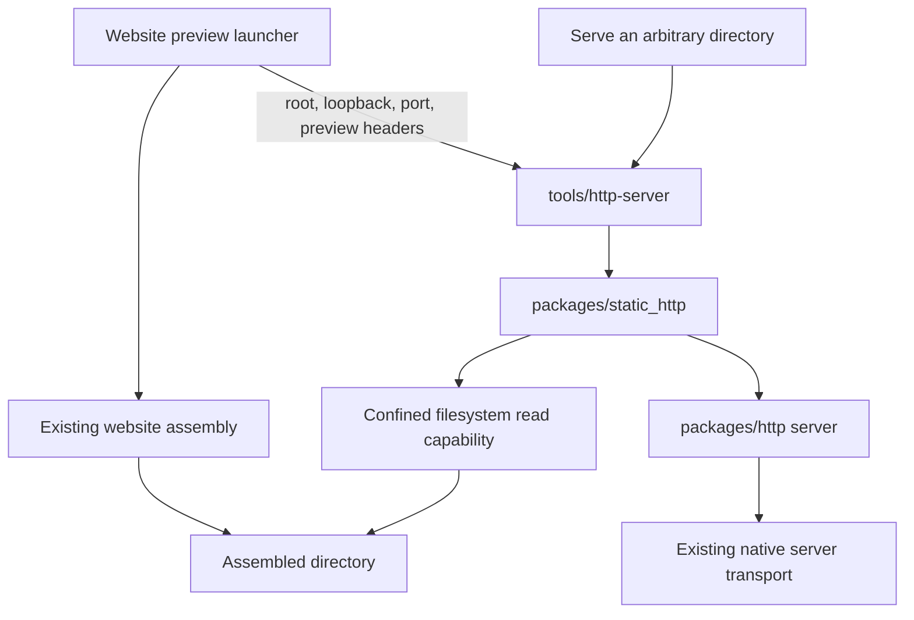
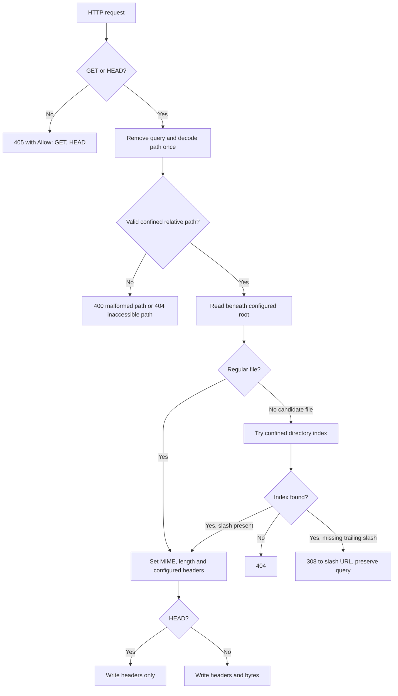
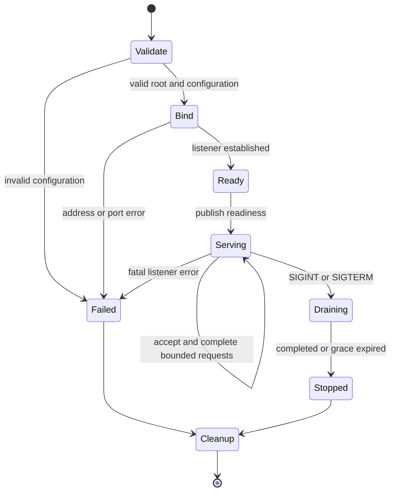
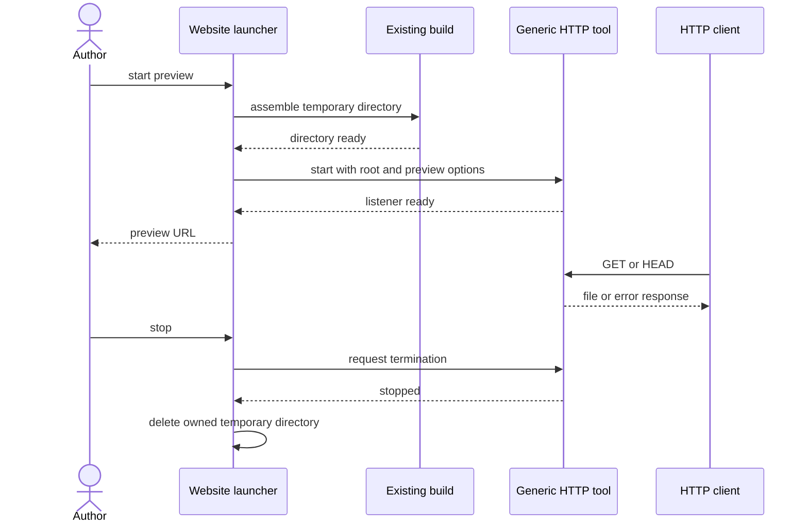

# GI#162: generic static HTTP service and website previews

Status: **released in alpha.13; GI#162 complete**. See the [tool guide](../../tools/http-server/README.md).

The implementation checkpoint and plan below are retained as dated design evidence
from 15 October 2026. HEAD support (PR #495),
asynchronous confined reads (PR #496), and continuous HTTP service lifecycle
(PR #497, merge `745ec02`) are delivered into `next`.

## Directory service implementation checkpoint

`packages/static_http` and `tools/http-server` now implement the generic service
and executable. No additional runtime or standard-library changes are needed in
this slice. HTTP connection policy selects GET/HEAD and carries configured headers
on connection-generated errors; existing HTTP callers retain GET/HEAD/POST.

Focused source, saved-bytecode and relocated-installation checks pass, including
URL decoding, confinement, redirects, HEAD, MIME, response limits, root replacement,
argument failures, occupied ports and signal-driven stop. Installation compiles the
tool once; launching the installed command runs saved bytecode from that installation.
The installed command needs neither an adjacent checkout nor the original location.
A separate lifetime probe served 64 requests over 63.99 seconds and stopped
normally, confirming operation beyond the old 60-second admission limit. Final
`make check` passed after the final product edit in 413 seconds, including unit,
functional, bootstrap, relocated distribution and release smoke checks. Package
PR delivery and website adoption remain pending at this checkpoint.

The lifecycle slice passed final `make check` in 523 seconds. Compiler seed stages
2–4 remain identical at
`9abb05684410344e9eed5ef9a2bc6dd30605be08eba38d6cb00aed71add3e3a5`.
This package slice changes neither compiler sources nor the seed.

### Performance evidence and proposed disposition

On the macOS arm64 development host, the existing assembled website contained 52
files, with a largest file of 706,607 bytes. Every file was fetched and compared
byte-for-byte through Node, source execution and saved-bytecode execution. Each
mode then ran 100 or 1,000 small requests, 20 largest-file requests sequentially,
and 20 with four concurrent clients. These are two local observations per mode,
not an isolated statistical benchmark or a general memory-growth proof.

| Mode | Readiness | Small-file median | Largest-file median | Four-client largest-file median | Peak process memory |
| --- | ---: | ---: | ---: | ---: | ---: |
| Existing Node server | 52–59 ms | 0.15–0.21 ms | 0.27–0.34 ms | 0.71–0.82 ms | 75–105 MiB |
| Panackelty saved bytecode | 16–18 ms | 7.0–7.9 ms | 11.1–12.9 ms | 26.4–34.9 ms | 17–24 MiB |
| Panackelty source | 1.34–1.35 s | 6.8–7.1 ms | 11.1–12.6 ms | 25.7–30.7 ms | 53–60 MiB |

The relative request-latency regression is material. Proposed disposition: accept
for the bounded development-preview workload because measured requests still
complete in milliseconds, use compiled installation to remove repeated source
startup cost, and retain the regression explicitly for website acceptance. The
GI#162 delivery maintainer owns the next action: check responsiveness of the actual
website assembly during adoption and revisit the disposition if it obstructs use.
This does not establish production-serving suitability or select general VM
optimisation. The roadmap performance scorecard tracks this concern.

Remaining delivery sequence:

1. Finish package review and final full validation, then open its PR to `next`.
2. Merge only after applicable checks pass for the exact PR head.
3. Adopt the installed tool in the website launcher, pin its implementation revision,
   retain assembly/provenance, and verify readiness, process cleanup and real pages.
4. Keep GI#162 open until website adoption and acceptance are complete.

## Design decision

Build a generic service that serves a directory, with a thin command-line tool
in `tools/http-server`. Website preview supplies the directory and preview
configuration. Keep website assembly in the website repository.

This records the user's direction: reuse the existing HTTP support, design the
general service first, keep the executable under `tools/`, and isolate any
standard-library additions. HTTP parsing and transport already exist. We don't
need another HTTP stack.

The original investigation identified finite session limits and asynchronous file
reads as prerequisites. Those prerequisites are now delivered. The historical
findings below explain the implementation choices; current contracts are in SPEC
and the package/tool READMEs.

## Package structure

```text
packages/
  http/                         existing HTTP client/server package
    src/server.panack           HEAD, explicit context, service entry point
  static_http/
    panack.json                 depends on ../http
    README.md
    src/service.panack          public configuration and serve entry point
    src/paths.panack            URL decoding and confined path selection
    src/mime.panack             content types
    tests/                     separate application manifest and fixtures
tools/
  http-server/
    panack.json                 application; depends on ../../packages/static_http
    README.md
    src/main.panack             arguments, diagnostics and exit status
```

Use the established `modules-v1` package manifests and explicit exports. Tests
have their own dependencies; implementation helpers don't become public exports
just to make them testable. The tool will use the existing project invocation form:

```sh
./bin/panack run --project tools/http-server/panack.json
```

Application arguments follow the project path directly, for example
`--root ./site --port 4173 --no-cache --noindex`. `make install` also installs
`panack-http-server`; see the [tool guide](../../tools/http-server/README.md).



The dependency runs from the website into a generic tool. No core package knows
about website routes, release metadata, preview banners or build commands.
The HTTP client remains available for consumers and integration checks; serving
files doesn't require an outbound request.

## Original investigation findings

| Existing behaviour | Consequence | Proposed response |
| --- | --- | --- |
| `http.serve` takes a named request callback; callable values cannot capture local state. | A handler cannot capture its root or header policy. | Add a context-bearing HTTP entry point, passing a typed configuration to the callback. Preserve the existing entry point. |
| Server children cannot invoke ordinary blocking effects. | Calling `package_filesystem.read_beneath` from an HTTP handler is currently invalid. | Add a narrowly scoped asynchronous confined read, reusing the existing rooted resolver. |
| A session accepts at most 256 clients and has an admission deadline of at most 60 seconds. | An author preview would stop while it is still in use. | Add a continuous service mode to the existing transport, with bounded concurrent work and signal-driven stop. |
| Existing results contain one report for every accepted client. | An endless service cannot retain the same report list. | Give continuous mode bounded diagnostics and summary counters, with no accumulated per-client history. |
| The HTTP parser currently accepts GET and POST, and the serializer always writes the response body. | HEAD requires package work. | Parse HEAD and suppress its wire body while preserving the corresponding GET representation headers. |
| Serialized HTTP responses and transport responses are capped at 1 MiB. | The advertised file ceiling must leave room for headers. | Retain the ceiling for the first delivery and calculate the file budget after response headers. |
| Confined reads already resolve beneath a held root descriptor and return its physical identity. | We can reuse established traversal and symlink protection. | Share the resolver and check the configured root identity across requests. |

The largest file found in the existing local assembled website was **706,607
bytes**, below the current response ceiling. This is evidence for that existing
assembly only. Acceptance must measure the actual assembly under review again.
A generic service can serve any directory within documented file and resource
limits. Streaming larger files is a separate capability unless acceptance shows
that the real website needs it.

Source references: [HTTP server](../../packages/http/src/server.panack),
[HTTP parser](../../packages/http/src/parser.panack),
[filesystem wrapper](../../src/stdlib/package_filesystem.panack),
[rooted resolver](../../src/vm/host_capabilities.c),
[server runtime](../../src/vm/tcp_server.c), and
[SPEC](../reference/SPEC.md), especially callable values, rooted reads and TCP server rules.

## Public service contract

The implemented `static_http/service.Config` contains:

- Root directory, validated before readiness.
- Bind address and port. Defaults: `127.0.0.1:8000`; website preview supplies 4173.
- Concurrency, request bytes, response bytes, client timeout and shutdown grace.
- Extra response headers, validated against control characters and reserved
  framing headers. Callers cannot override Content-Length or connection framing.

Keep `index.html` as the initial directory index. Directory listings are off.
There is no implicit single-page-app fallback: a missing route returns 404.
The tool defaults to loopback; an explicit IPv4 host can support another local
use case. Network exposure and hosting are outside website-preview acceptance.

Tool resource defaults are four concurrent clients, 16 KiB request
budget, 1 MiB total response budget, ten seconds per client and one second of
shutdown grace. Recheck these against the actual website during adoption.
Keep the existing finite server contract and defaults intact.

The generic service reads files per request, so edits become visible on the next
request. It doesn't watch sources or rebuild a site. For website previews,
source changes still require the existing rebuild/restart workflow.

### Request processing



Decode percent escapes once. Reject malformed escapes and NUL; define the first
version's URL-to-filesystem mapping as UTF-8. Reject decoded traversal segments,
absolute paths and ambiguous separators before calling the rooted resolver.
A query string never becomes part of a filename. Redirect targets must be safely
encoded rather than copied into headers unchecked.

A file read, including an index read, must remain confined during resolution.
Do not implement containment as a string prefix check or a check-then-open
sequence. Reuse the existing policy: relative symlinks staying under the root
are allowed; absolute links, escapes and loops are denied. Pin the root's
physical identity at startup and reject a replacement root on later reads.
Concurrent edits are visible, but no snapshot consistency is promised.

Return 404 for absent or inaccessible paths without exposing host paths. Return
400 for malformed URLs. Unexpected internal failures return 500 and a concise
server diagnostic. An oversized file returns a small explicit error response
(proposed 503) and logs the configured limit; never send a partial 200 response.
An index probe must distinguish expected file-type/missing errors from I/O
failures instead of turning every failure into a fallback.

The MIME table must cover the website's existing extensions and common generic
files: HTML, CSS, JavaScript, JSON, text, SVG, raster images, icons, fonts and
binary assets. Unknown extensions use `application/octet-stream`. Text MIME
values declare UTF-8 where applicable. Keep filenames and bytes unmodified.

HEAD produces the same status and representation headers as GET, including the
representation length, with no body on the wire. Apply suppression to error and
redirect responses too. Initially reading the bounded file for HEAD is acceptable;
an additional metadata API is unnecessary for correctness.

### HTTP compatibility

Keep existing `serve` and `ServerLimits` callers valid. Introduce a separate
service configuration and context-bearing entry point rather than extending a
shared positional record in place. The HTTP layer owns method parsing, framing,
HEAD suppression and connection handling. The static service owns its allowed
methods and file policy. Preserve POST for existing HTTP applications.

Any context API should use the language's supported generic callable/record
forms. Confirm a minimal typed callback example before fixing signatures. No
closure implementation is required.

## The narrowly scoped runtime prerequisites

### Asynchronous confined file reads

Expose the new capability in an isolated filesystem module. Keep the synchronous
package-loading API unchanged and reuse its resolver implementation.

The new operation must bound input paths, bytes and pending work; return typed
host errors; and release descriptors and buffers on every outcome. A slow read
must not block the server event loop or other clients. Cancellation must suppress
late results and keep worker state alive until it is safe to release it.

Implementation gate: establish how a bounded filesystem worker integrates with
the existing scheduler and cancellation model before adding the API. Cancellation
of a host read cannot simply be assumed to interrupt arbitrary filesystem I/O.
Document supported local-filesystem behaviour and the shutdown consequences of a
stuck read. If that cannot meet the stop contract with a small extension, return
to the design with the concrete trade-off before expanding runtime scope.

Preloading an entire directory is unsuitable as the default: it changes edit
visibility and makes memory scale with the whole site. Repeatedly restarting a
finite server would introduce port gaps and doesn't solve file access.

Implementation decision, 15 October: retain asynchronous reads, as confirmed by
the user after the cancellation/harness scope checkpoint. The isolated adapter
uses bounded independently owned native workers and an explicit filesystem grant.
Logical cancellation drops result delivery immediately; physical read cleanup
may finish later while retaining its worker slot. Add root-identity lookup so an
empty directory can be validated without requiring an index file. Keep the
synchronous package-loading API intact.

The generic callback investigation also confirms that the language supports a
concrete worker wrapper calling a generic connection helper with explicit state.
Use that pattern rather than adding generic function references.

### Continuous serving and clean stop

Extend the current server engine with an explicit continuous mode. Keep finite
sessions and their ordered reports unchanged. Continuous mode must retain only
active clients, bounded diagnostics and counters with defined saturation.



Signals request stop through the host lifecycle; signal handlers must not invoke
Panackelty callbacks or allocate VM state. Stop admission, drain active clients
within the grace period, cancel remaining work and release the listener. A second
signal may request immediate cancellation. No general user signal framework is
needed for this task.

Readiness is emitted only after the listener is bound and root validation has
succeeded. Decide a small documented readiness event that the launcher can
consume, including the actual bound address and port. The existing API returns
only when serving ends, so readiness needs explicit support rather than printing
an optimistic URL before calling it. Port 0 is useful for tests if supported;
otherwise retain the existing test harness's port allocation and retry policy.

This is the justification for touching the underlying server: persistent service,
bounded state and deterministic stop. Parsing, routing and file policy stay above
it, and the existing transport is reused.

## Website integration

The existing Node launcher remains responsible for assembly, preview metadata,
banners, temporary directories and process orchestration. Replace its serving
component with the generic Panackelty tool.



Preview options are loopback, selected port, `Cache-Control: no-store` and
`X-Robots-Tag: noindex`. Apply those headers to errors and redirects as well as
successful responses. Preserve preview banners and provenance produced by the
build. Preserve a `serve` path for an already assembled directory.

Wait for confirmed readiness before printing success. Forward termination to
the child, wait for exit, then remove only the launcher's own temporary directory.
A supplied directory must survive shutdown. Build failure, spawn failure, port
conflict and unexpected child exit all need clear diagnostics and cleanup.
A parent crash may need a separate child-lifetime safeguard; establish the process
ownership mechanism in the integration slice rather than assuming signal forwarding
covers every termination path.

For development, support an explicit core/tool location. For repeatable website
use and CI, pin the required tool source and compatible native runtime, verify
them, and cache the result. Do not assume an adjacent checkout on every machine.
The integration PR must choose the exact distribution path and version, document
it, and avoid compilation or downloading on every preview start. Until that
contract exists, the current launcher remains the supported preview route.

The assembled-site browser suite must connect to this server. Merely retaining
an independently configured Node test server would not prove GI#162 acceptance.
Inspect the staged test configuration used by the website workflow when changing
this: its shared configuration is supplied during staging.

## Delivery sequence

Five proposed implementation PRs, with the first two providing reusable
prerequisites. This is a medium-to-large task because of runtime lifecycle work;
the static routing code is the smaller part. PR boundaries may be combined if
that reduces validation cost without hiding a contract change.

| Slice | Deliverable | Exit evidence |
| --- | --- | --- |
| 1. Confined async reads | Isolated API, shared resolver, bounded scheduling and cancellation semantics | Small handler can read a file; traversal, oversize, error and cancellation behaviour established |
| 2. Persistent HTTP service | Continuous lifecycle, bounded reports, stop/readiness, explicit handler context and HEAD | Serve beyond 256 requests and 60 seconds; correct HEAD bytes; bind failure and drain checks; finite APIs still work |
| 3. Generic directory service | `packages/static_http` and `tools/http-server`, docs and argument contract | Serve an arbitrary fixture tree through the CLI; path/MIME/index/error matrix passes |
| 4. Website adoption | Launcher uses the pinned tool; existing build and cleanup behaviour retained | Real assembled site loads through Panackelty; start, rebuild/restart and stop documented |
| 5. Acceptance and completion | Full website acceptance evidence and delivery records | Required checks pass, final assembly fits limits, issue and roadmap accurately record delivery |

Slice 2's HTTP work can be investigated while slice 1 is underway, but static
service acceptance depends on both. Slice 5 can be folded into slice 4 if all
cross-repository prerequisites are available. Do not mark the issue complete
when only the generic tool exists.

Before the runtime slices, settle three engineering details in small source-level
prototypes: async filesystem cancellation, the typed context signature, and the
host stop/readiness boundary. If these require broader language or runtime work,
report the revised scope before proceeding.

## Validation plan

The original validation matrix follows; delivery evidence is recorded in the
implementation checkpoints above and the coverage document.

| Area | Cases |
| --- | --- |
| HTTP | GET/HEAD wire bytes, error HEAD, Content-Length, unsupported method, existing POST, malformed request, connection close |
| Paths | Root and nested index, slash redirect/query, missing file, spaces/Unicode, malformed encoding, encoded traversal and separators, NUL, sibling-prefix escape |
| Filesystem | Relative symlink inside root, escape/absolute link/loop, root replacement, directory/special file, file removal during read, exact limit and one byte over |
| Resource bounds | Concurrent clients, slow request, read cancellation, request and response ceiling, bounded retained state across many requests |
| Lifecycle | Invalid root/options, port conflict, confirmed readiness, idle beyond 60 seconds, more than 256 requests, interrupt/termination, port reuse, no child left behind |
| Tool | Manifest dependency resolution, source and compiled execution, CLI parsing/help, diagnostics and nonzero failure status |
| Website | Existing preview tests, actual assembled assets and MIME, no-cache/noindex, preserved supplied output, owned-temp cleanup, desktop and phone viewport browser suite |

During implementation, start with the smallest applicable compile/check or focused
fixture. Run required broad validation after the final product edit and preserve
all merge gates. Reuse cached assembly and dependencies; don't queue full builds
for each small edit. The intentional lifetime check runs once at the appropriate
acceptance stage rather than on every iteration.

Performance evidence should include warm startup, representative request latency,
peak memory under configured concurrency and retained memory over a long request
sequence. Compare with the existing launcher using the same assembled directory.
Record observations and explain material regressions; don't invent timing budgets
before measuring the baseline.

### Filesystem adapter measurement, 15 October

A local warm-cache comparison on macOS 26.5 arm64 used the same native runtime
and separately compiled programs, each reading a 706,607-byte file 100 times.
Compilation was excluded and each mode had one warm-up followed by three runs.
Synchronous confined reads took 0.0111, 0.0120 and 0.0114 seconds; asynchronous
reads took 0.0132, 0.0129 and 0.0134 seconds. The measured additional time was a
few milliseconds per 100 reads. These short runs include process startup noise
and establish neither cold-disk performance nor HTTP serving throughput. Retain
the asynchronous design for request responsiveness and cancellation; remeasure
whole-server behaviour when the generic service is available.

### Lifecycle resource assessment, 15 October

The continuous mode uses the existing fixed 32-client transport storage and
bounded counters rather than retaining a result per accepted client. The native
300-request assertion crosses the old 256-client session limit and verifies the
summary; it is a correctness check, not a throughput or retained-memory benchmark.
Console output adds at most four retained workers, each holding a copied message
of at most 16 KiB plus newline and one descriptor. Abandoned host writes retain
those resources until completion. Existing finite HTTP interoperability passes.
The final full check took 523 seconds; the previous review run took 582 seconds.
These are local wall times with concurrent draft investigation, not isolated
performance comparisons. Historical validation budgets are being reassessed under
GI#106. Complete runtime diff review before starting broad validation on subsequent
slices to avoid repeating the full run for a late compatibility fix.
Whole-server startup, latency and peak-memory observations are recorded above;
final website assembly acceptance remains part of adoption.

Documentation review: SELF_HOSTING needs no milestone change; the refreshed seed
has the same bytecode version and verified fixed point. No current website claims
or release pins change in this intermediate slice. Website launcher adoption
remains the final GI#162 step.

## Scope and remaining decisions

The initial delivery excludes TLS, production deployment, directory listings,
compression, range responses, upload/write methods, source watching and automatic
reload. File edits are visible on another request; generated site changes require
rebuilding. Retain bounded responses unless measured acceptance requires more.

No product decision currently needs to block planning. The recommended defaults
are loopback, `index.html`, ordinary 404s, no directory listing and explicit
preview headers. Larger-file support and live reload would change the scope and
should be separately requested.

Before calling this complete, record the tool/runtime distribution choice and
minimum supported version, measured asset limits, lifecycle semantics and actual
acceptance results. Update the core roadmap and affected SPEC, architecture,
package/tool documentation and coverage records with their respective slices.
The website change concerns local preview tooling; it does not change production
hosting or make a loopback URL reachable from another device.
